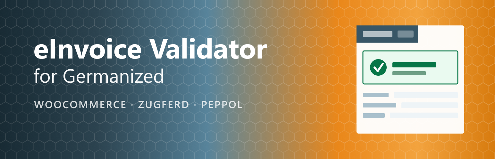

# eInvoice Validator for Germanized

**Checks every e-invoice that Germanized Pro creates against the official rules, in your shop, and holds back a faulty
invoice before it goes out.**

This is an independent plugin. It is not made by vendidero, the maker of Germanized.

## Why

Germanized Pro creates e-invoices for your WooCommerce orders, but it does not check them. A faulty e-invoice is usually
noticed only when the customer rejects it, and by then it has a number and needs a cancellation. This plugin checks the
invoice while it is still a draft.

## How it works

1. Germanized Pro creates the invoice of an order as a draft, as always.
2. The plugin lets Germanized Pro write the e-invoices of the draft in memory and checks them against EN 16931 and its
   national rules.
3. If they are valid, the plugin finalizes the invoice, and Germanized Pro numbers and sends it as usual.
4. If they have errors, the invoice stays a draft. You get a note at the order and a mail that names every error in plain
   words, with the field and what to do.
5. After you correct the order, you click "Check again".

The order itself is never touched. Checkout, payment, order status and downloads run as always; only the invoice waits.

## Features

| | |
|---|---|
| **Formats** | Every file Germanized Pro creates automatically: ZUGFeRD in its profiles, XRechnung and Peppol BIS Billing 3. |
| **Per customer class** | Hold back, finalize and only report, or do not check, separately for businesses and private customers. |
| **Checkout fields** | Optional fields for public authorities with Leitweg-ID ( check digits tested ), the buyer's order number and the Peppol ID, in the block checkout and the classic checkout, kept at the customer. |
| **Reports** | Every check leaves a report in the format of the KoSIT validator at the order, in a folder closed to direct access. |
| **Self-test** | Finds settings that would make every e-invoice fail: seller data, bank account, the automatic creation of e-invoices, the company field of the checkout, memory. |
| **No external service** | The check runs on your server with the validation engine [VAMPIRE PHP](https://github.com/invoicepress/vampire-php). Nothing is sent anywhere. |

## Requirements

- WordPress 6.4 or later, WooCommerce and Germanized Pro
- PHP 8.2 or later; a check adds about 25 MB of memory, 256 MB are recommended

## Installation

1. Install and activate WooCommerce and Germanized Pro.
2. In Germanized Pro, switch on the automatic creation of e-invoices and the automatic finalization of invoices.
3. Download the ZIP of the latest [release](https://github.com/invoicepress/einvoice-validator-for-germanized/releases/latest) and install it under *Plugins → Add New → Upload
   Plugin*.
4. Open *WooCommerce → eInvoice check → Self-test* and fix what it reports.
5. Choose the modes for businesses and private customers under *WooCommerce → eInvoice check → Settings*.

The full manual is in the plugin under [`manual/`](../manual/), in English and German.

## License

GPL-2.0-or-later. Made by [invoicePress](https://invoicepress.de/).
